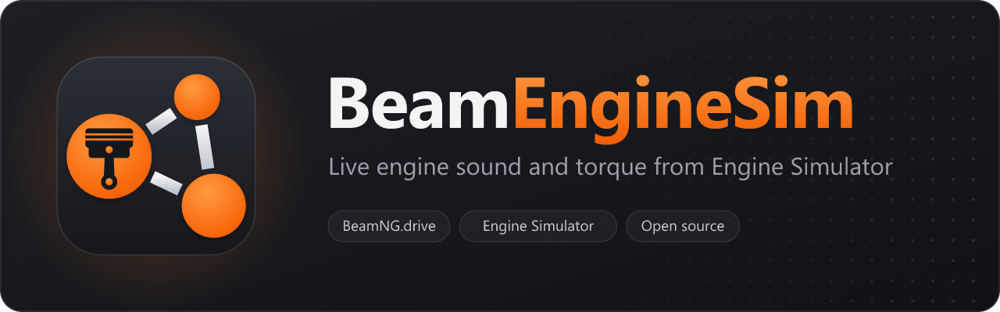

[](https://youtu.be/0cbpjeDoqT0)

Real engine sound in BeamNG.drive, generated live by [Engine Simulator](https://github.com/ange-yaghi/engine-sim).

Engine Simulator models every piston, valve, spark and exhaust pulse of an engine and turns that into sound. BeamEngineSim connects it to BeamNG.drive, so the car you drive sounds like the engine you loaded, and that engine also drives the car.

- Works with any car in BeamNG.drive and any engine file (`.mr`), including most Community Edition engines.
- The sound plays inside the game's own audio, positioned at the engine and exhaust like stock sounds.
- BeamNG.drive tells Engine Simulator the rpm, throttle and ignition. Engine Simulator sends back the torque its engine makes.
- Optional: tune the car's engine to match the loaded one (idle, redline, torque curve, inertia), so it revs the way it sounds.

## Install

1. Download `BeamEngineSim-Setup-x.y.z.exe` from [Releases](https://github.com/spidermodders/BeamEngineSim/releases) and run it.
2. Setup finds BeamNG.drive and your user folder on its own. If it can't, it asks you for them.
3. Start EngineSim, then start BeamNG.drive and get in a car.

Running setup again when BeamEngineSim is already installed repairs the install, or updates it if the setup is newer.

Uninstalling puts the game's original audio plugin back and removes the mod.

## Using it

EngineSim opens two windows: the simulator itself and a small settings window. The top of the settings window shows whether BeamNG.drive is connected and the simulator's FPS. Disconnect hands the sound back to EngineSim's own window and gives the car its stock engine sound again; Connect links it back up.

| Setting | What it does |
| --- | --- |
| Load engine | Pick any `.mr` engine file. |
| Simulation rate | Higher sounds cleaner but costs more CPU. 10 kHz is a good default. |
| Volume in BeamNG | Volume of the engine inside BeamNG.drive. |
| BeamNG torque below | Below this rpm the car uses its stock torque, which keeps idle steady. |
| Tune car to this engine | Reshapes the car's engine to the loaded engine. Any car, no extra mod needed. |
| Retune | Measures the engine again and re-applies it, for example after switching cars. |

## What gets installed

| File | Where |
| --- | --- |
| EngineSim | The folder you pick (default `Program Files\BeamEngineSim`) |
| `engineSimBridge.zip` | `<BeamNG user folder>\current\mods` |
| `BeamNGBlendLayerDSP.dll` | `<BeamNG.drive>\Bin64`, the original is kept as `.orig` |

The audio plugin replaces an FMOD plugin the game loads at startup. It passes the game's own sound through unchanged and only feeds Engine Simulator's audio into the player car's engine and exhaust sounds. After a BeamNG.drive update, run setup again and pick Repair.

## Building

Requirements: Visual Studio 2022 with the C++ workload, CMake, Git and [Inno Setup 6](https://jrsoftware.org/isdl.php) for the installer.

```
git clone --recursive https://github.com/spidermodders/BeamEngineSim.git
cd BeamEngineSim
Build.bat
```

Pick what to build, or pass it directly: `Build.bat enginesim`, `dsp`, `mod`, `installer` or `all`. The first build downloads its dependencies (vcpkg, SDL2, Boost, MinHook, WinFlexBison) into `Dependencies`. Output goes to `out`.

`Commit.bat` commits and pushes, and optionally builds everything and publishes a GitHub release with the installer attached.

## Repository layout

| Folder | Contents |
| --- | --- |
| `EngineSimulator` | Fork of Engine Simulator v0.1.12a with the BeamNG bridge, plus small patches for its libraries |
| `EngineSimulatorMod` | The BeamNG.drive mod (vehicle Lua, sound markers, mod icon) |
| `AudioPlugin` | The FMOD plugin that brings the audio into the game |
| `Installer` | Inno Setup script |
| `Icon` | Icon and README banner: SVG sources, VectorCraft projects, PNG and .ico |
| `Dependencies` | vcpkg manifest. Build.bat downloads everything else in here |

## Credits

- [Engine Simulator](https://github.com/ange-yaghi/engine-sim) by AngeTheGreat (Ange Yaghi), MIT license. This project uses a modified fork of the open source version: the simulation runs on its own thread, a UDP bridge to BeamNG.drive, a settings window, the engine profiling for tuning and some fixes.
- [delta-studio](https://github.com/ange-yaghi/delta-studio) and [piranha](https://github.com/ange-yaghi/piranha) by Ange Yaghi, used as submodules with two small patches.
- [MinHook](https://github.com/TsudaKageyu/minhook) by Tsuda Kageyu, BSD 2-Clause license.
- The way setup finds the BeamNG.drive user folder follows the [BeamMP Launcher](https://github.com/BeamMP/BeamMP-Launcher).

BeamNG.drive is a trademark of BeamNG GmbH. This project is not affiliated with BeamNG GmbH or AngeTheGreat.

## License

MIT, see [LICENSE](LICENSE). Engine Simulator keeps its own MIT license in [EngineSimulator/LICENSE](EngineSimulator/LICENSE).
